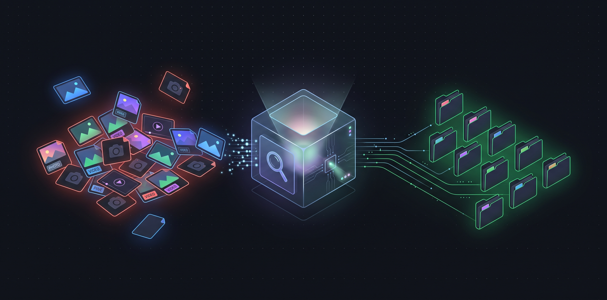

🌐 [English](README.md) | [Polski](README.pl.md) | **Українська**

---

# Dedup sorter



Інструмент для впорядкування фото- та відеоархіву: виявлення точних дублікатів, розпізнавання серій та візуально схожих фотографій, групування в поїздки/події, сортування "вхідної скриньки" та стиснення відеофайлів, що займають занадто багато місця.

[](https://www.python.org/downloads/)
[](https://opensource.org/licenses/MIT)
[](https://buymeacoffee.com/mbohdan)

**За замовчуванням нічого не видаляється.** Інструмент працює в режимі dry-run — поки ви прямо не попросите, він лише звітує про те, що пропонує зробити. Навіть застосування змін не призводить до видалення файлів з диска: вони переміщуються до кошика `!REMOVE` разом із маніфестом, який дозволяє повністю скасувати всі операції. Безповоротне видалення завжди виконується вручну.

**Лише Windows 10/11.** Інструмент використовує API Win32 (довгі шляхи, junctions, жорсткі посилання); Linux і macOS не підтримуються.

**Де розмістити проект?**
Каталог `.dedup` з завантаженим репозиторієм має знаходитися **безпосередньо в кореневому каталозі вашого архіву**, з яким ви працюєте. Інструмент обробляє свою батьківську папку.
Під час кожного запуску інструмент створює в архіві спеціальні каталоги, яких бракує:
- `!NEW` – вхідна скринька для нових фотографій, що чекають на сортування
- `!MOVES` – історія маніфестів та копій операцій
- `!REMOVE` – безпечний кошик, куди потрапляють відхилені дублікати (програма ніколи не видаляє їх назавжди)

Стартові скрипти `run.cmd` / `run.ps1` / `run.sh` суворіші: вони завершують роботу, якщо `!NEW` ще не існує, тому створіть його заздалегідь (крок 4 нижче).

## Швидкий старт

Потрібні: Windows 10/11, Python 3.10 або новіший та Git.

> **Встановлення Python у Windows:**
> Якщо Python ще не встановлено:
> 1. Завантажте інсталятор з офіційного сайту [python.org/downloads](https://www.python.org/downloads/) або виконайте в PowerShell: `winget install Python.Python.3.12`
> 2. **Важливо:** В інсталяторі обов'язково поставте прапорець **"Add python.exe to PATH"** перед початком встановлення.
> 3. Перевірте встановлення у новому вікні терміналу: `python --version`

1. Перейдіть до папки вашого архіву (того, який хочете впорядкувати):
   ```bat
   cd D:\MyArchive
   ```
2. Клонуйте репозиторій у підпапку `.dedup` та встановіть залежності:
   ```bat
   git clone https://github.com/bogdan580/dedup-sorter.git .dedup
   cd .dedup
   python -m pip install -r requirements.txt
   ```
3. Необов'язково: скопіюйте шаблон конфігурації та відредагуйте його (без `config.json` діють типові значення):
   ```bat
   copy config.example.json config.json
   ```
4. Необов'язково, для сортування вхідної скриньки: створіть папку `!NEW` у корені архіву (і складайте туди нові фотографії):
   ```bat
   mkdir ..\!NEW
   ```
5. Двічі клацніть `run.cmd` (або запустіть `.\run.ps1` у PowerShell чи `./run.sh` у Git Bash). Інтерфейс перегляду відкриється в браузері.

**Під час першого запуску завантажується ffmpeg** (~200 МБ, перевірка SHA-256), потрібний для стиснення відео. Це єдиний доступ проекту до мережі; наступні запуски повністю офлайн, а сам `dedup.py` ніколи не виходить в інтернет. Якщо завантаження не вдасться, інтерфейс перегляду все одно запуститься, лише без стиснення. Деталі: [вбудований бінарний файл ffmpeg](docs/technical/components/compression-mechanism.md#bundled-ffmpeg-binary).

Команди CLI запускайте з кореневого каталогу архіву (а не зсередини `.dedup`), бо відносні `--roots` визначаються відносно поточного каталогу:

```bat
cd D:\MyArchive
python .dedup\dedup.py --review
```

| Команда | Опис |
|---|---|
| `python .dedup\dedup.py` | сканування всього архіву, без змін на диску |
| `python .dedup\dedup.py --review` | відкриває вебінтерфейс для перегляду — саме тут приймаються рішення |
| `python .dedup\dedup.py --apply` | переміщує відхилені дублікати до кошика |
| `python .dedup\dedup.py --restore MANIFEST` | скасовує цілий пакет операцій |
| `python .dedup\dedup.py --inbox` | сортування скриньки `!NEW`, генерує HTML звіт |
| `python .dedup\dedup.py --compress` | вказує відео, які варто перекодувати, без змін на диску |


## Документація

Інструмент має розгорнуту архітектуру та набір бізнес-правил. Повна документація (англійською мовою) знаходиться в каталозі [`docs/`](docs/index.md) — це єдине джерело правди.

| Що ви шукаєте | Перейдіть до |
|---|---|
| Чи може це видалити мої фото? | [гарантії безпеки](docs/business/guarantees.md) |
| Як встановити | [встановлення](docs/business/instructions/installation.md) |
| Що робить певний прапорець | [довідник CLI](docs/business/instructions/CLI.md) |
| Типові сценарії | [сценарії роботи](docs/business/instructions/workflows.md) |
| Який примірник залишається і чому | [вибір версії](docs/business/rules/version-selection.md) |
| Яке відео варто стиснути | [правила стиснення](docs/business/rules/compression.md) |
| Щось не працює (відомі помилки) | [обмеження](docs/business/instructions/limitations.md) |
| Як це влаштовано зсередини | [архітектура](docs/technical/architecture.md) |

## Стиснення відео

Стиснення використовує ffmpeg, який не є частиною репозиторію: стартові скрипти завантажують зафіксовану збірку з перевіркою контрольної суми під час першого запуску (див. Швидкий старт), тому ручне встановлення не потрібне. Деталі: [механізм стиснення](docs/technical/components/compression-mechanism.md).

## Тестування та розробка

Для тих, хто бажає долучитися до написання коду (включаючи AI-агентів — див. [AGENTS.md](AGENTS.md) та [CONTRIBUTING.md](CONTRIBUTING.md)):

```bash
python -m pip install -r requirements-dev.txt
python -m pytest -q
```

Конвенції, стиль написання коду та стан набору тестів: [тести та конвенції](docs/technical/development/conventions-and-tests.md). Код намагається не містити розлогих коментарів — деталі бізнес-логіки знаходяться в документації, а з коду ведуть лише "якорі" (наприклад, `# See: docs/business/rules/...`).

## Ліцензія

Проект поширюється на умовах ліцензії [MIT](LICENSE). ffmpeg завантажується окремо (GPLv3, збірки BtbN) і не є частиною цього репозиторію.
